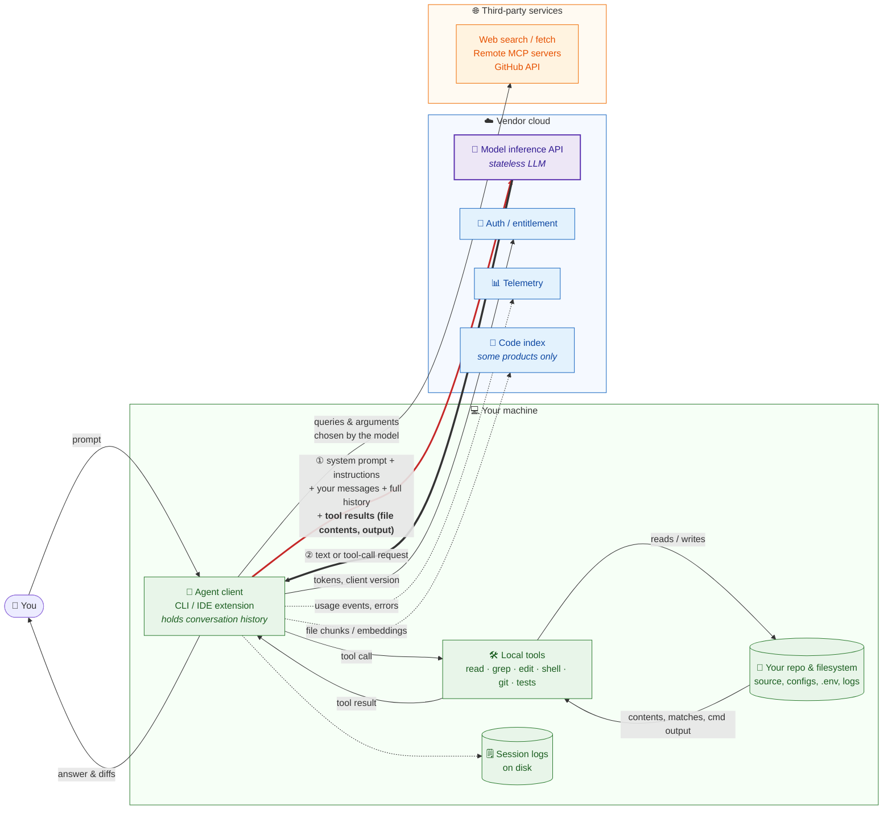

# Data Flow: What Is Sent to Servers

## High-level diagram

**Legend:** 🟥 thick red = the main path where your code leaves the machine · ━ thick = model round-trip · ┄ dotted = optional / product-dependent · 🟩 local · 🟦 vendor · 🟧 third-party

> The model never touches your disk. It only sees what the agent client puts in step ①, and the most sensitive part of that is **tool results**: file contents, search matches and command output.

## Destinations

| Destination | Purpose | Typical content |
|-------------|---------|-----------------|
| **Model inference API** | Generate responses | Prompts, history, tool results (file contents, command output) |
| **Auth service** | Login, token refresh, entitlement checks | Account tokens, client version |
| **Telemetry / analytics** | Product metrics, error reports | Event names, durations, token counts, error stacks, client version, OS; *may* include snippets depending on settings |
| **Tool backends** | Web search, GitHub API, remote MCP servers | Queries and parameters chosen by the model |
| **Code indexing service** (some products) | Semantic search | Chunks or embeddings of repo files |

## Model request contents (per turn)

| Item | Sent? | Notes |
|------|-------|-------|
| System prompt + tool schemas | ✅ every turn | Vendor-authored |
| Your messages | ✅ | |
| Environment info | ✅ usually | cwd, OS, shell, date, sometimes git branch/remote |
| Repo instruction files | ✅ if present | `AGENTS.md`, `copilot-instructions.md`, etc. |
| Files the agent **read** | ✅ | Full or truncated content |
| `grep`/search **matches** | ✅ | Matching lines, which may include secrets |
| Shell command **output** | ✅ | `env`, `cat .env`, `printenv` would leak secrets |
| Files the agent **edited** | ✅ partially | Edit arguments contain old/new text |
| Files **never touched** | ❌ | Unless an indexing feature uploaded them |
| Open editor tabs / selection | ⚠️ IDE agents | Often added as implicit context |
| Images / screenshots | ✅ if attached | |

## What the server does with it

This is policy, not technology, and varies by product and plan. Questions to look up for your tool:

1. Is prompt/response data **retained**? For how long?
2. Is it used to **train models**? Is that opt-in or opt-out? Does it differ for business/enterprise plans?
3. Which **third-party model providers** see the data, and under what terms (zero data retention agreements)?
4. Where is data processed (data residency)?
5. Is telemetry configurable / can it be disabled?

See [privacy-and-security.md](privacy-and-security.md) for links.

## Key mental model

> **The model's view of your repo = the union of everything the agent's tools have returned during the session.**

If you wouldn't paste it into a chat window, don't let the agent `cat` it.
